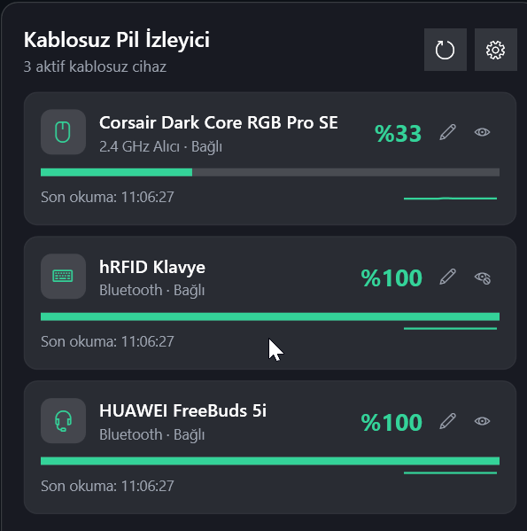
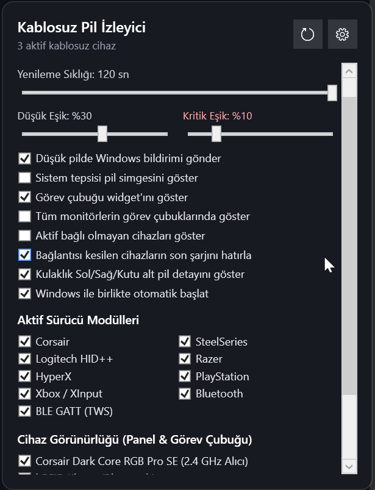

# Kablosuz Pil İzleyici (Wireless Battery Monitor)

**Windows 10 & 11 için hafif, üretici yazılımı (bloatware) gerektirmeyen görev çubuğu pil göstergesi ve modern açılır kontrol paneli.**

[-0078D4?logo=windows)](https://github.com/erbayfaruk61/WirelessBatteryMonitor)

 

[**🚀 En Son Sürümü İndir (Releases)**](https://github.com/erbayfaruk61/WirelessBatteryMonitor/releases/latest)

---

## 📸 Ekran Görüntüleri

  
  &nbsp;&nbsp;
  

  

---

## ✨ Öne Çıkan Özellikler

- **Görev Çubuğu Widget'ı & Çoklu Monitör Desteği:** Birincil ve ikincil monitörlerdeki görev çubuklarının sağ tarafına yerleşir; Z-order koruması sayesinde sistem tepsisi simgelerine tıklandığında kaybolmaz.
- **Modern Windows 11 Flyout Paneli:**
  - Cihaz türü simgesi, bağlantı türü (`2.4 GHz Alıcı`, `Bluetooth`, `Xbox Wireless`), pil yüzdesi ve renkli ilerleme çubuğu.
  - **Mini Pil Geçmişi Grafiği (Sparkline)** ve saatlik deşarj/şarj hızına göre **tahmini kalan süre**.
  - Destekleyen BLE cihazlar için **Sol / Sağ / Kutu** alt pil dağılımı.
- **Çift Kademeli Pil Uyarı Sistemi:**
  - **Düşük Pil Eşiği** (varsayılan `%30`, sarı gösterge + Windows bildirimi).
  - **Kritik Pil Eşiği** (varsayılan `%10`, ikinci uyarı bildirimi + görev çubuğu simgesinde kırmızı **yanıp sönme** animasyonu).
- **Tamamen Esnek ve Yönetilebilir Ayarlar:**
  - Yenileme sıklığı (`5–120 sn`), düşük ve kritik eşik kaydırıcıları.
  - Sistem tepsisi simgesi, görev çubuğu widget'ı, tüm monitörler ve bağlı olmayan cihazları göster/gizle seçenekleri.
  - **Cihaz Bazlı Özelleştirme:** Her cihaz için özel isim ve özel uyarı eşiği tanımlama, panelden veya görev çubuğundan ayrı ayrı gizleme.
  - **Modüler Sürücü Yönetimi:** Her marka/protokol okuyucusunu ayarlardan tek tıkla açıp kapatabilme.
  - **Uyku Modu Koruması:** 2.4 GHz fareler uykuya geçtiğinde pilin `%0` görünmesini engelleyip son geçerli değeri koruma.
  - Windows ile otomatik başlatma ve yeni cihaz desteği için **HID/USB Raporu Kopyala** aracı.

---

## 🎮 Desteklenen Cihazlar ve Okuyucular

| Modül | Protokol / Yöntem | Örnek Cihazlar |
|---|---|---|
| **Corsair** (`CorsairDeviceReader`) | Doğrudan USB HID (Bragi / Slipstream & Void) | Dark Core RGB Pro SE, Void RGB Elite Wireless, HS70 / HS80 |
| **SteelSeries** (`SteelSeriesDeviceReader`) | Doğrudan USB HID | Rival 3 Wireless / Gen 2, Rival 650, Aerox 3/5/9, Prime Wireless |
| **Logitech** (`LogitechDeviceReader`) | HID++ 2.0 (`0x1004` / `0x1000`) | Lightspeed, Unifying, Bolt fare ve klavyeler |
| **Razer** (`RazerDeviceReader`) | Doğrudan USB HID | BlackShark V3 Pro ve desteklenen Razer kablosuz cihazlar |
| **HyperX** (`HyperXDeviceReader`) | Doğrudan USB HID | Cloud Alpha Wireless, Cloud II / III / III S Wireless |
| **Xbox** (`XboxControllerReader`) | `Windows.Gaming.Input` (mWh) & `XInput` | Xbox One / Series / Elite kablosuz oyun kolları |
| **PlayStation** (`PlayStationDeviceReader`) | Doğrudan USB / BT HID | DualSense, DualSense Edge, DualShock 4 |
| **Windows Bluetooth** (`BluetoothDeviceReader`) | PnP `DEVPKEY_Bluetooth_Battery` | Huawei FreeBuds 5i, Logitech Lift, Bluetooth klavye/fare/kulaklıklar |
| **BLE GATT** (`BleGattBatteryReader`) | GATT Battery Service (`0x180F`) | Standart BLE çoklu/tekli pil yayınlayan cihazlar |

---

## 🚀 İndirme ve Kullanım

Doğrudan kullanmak için herhangi bir geliştirme ortamı kurmanıza gerek yoktur:

1. [**Releases**](https://github.com/erbayfaruk61/WirelessBatteryMonitor/releases/latest) sayfasından en son sürümü indirin:
   - `WirelessBatteryMonitor.exe` (Doğrudan çalışan tek dosya) veya `WirelessBatteryMonitor-portable.zip`.
2. Dosyayı çalıştırın. Uygulama sistem tepsisinde ve görev çubuğunda saatin solunda açılacaktır.

---

---

## 📄 Lisans

Bu proje [MIT Lisansı](LICENSE) ile lisanslanmıştır.
